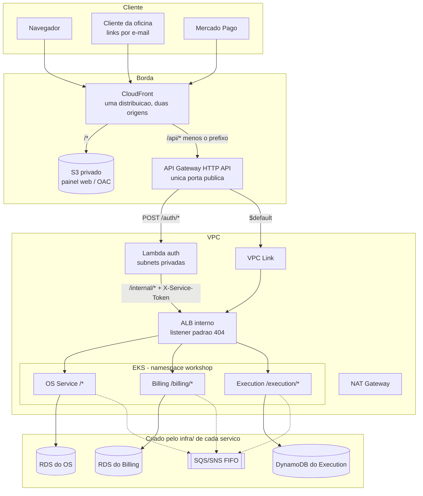
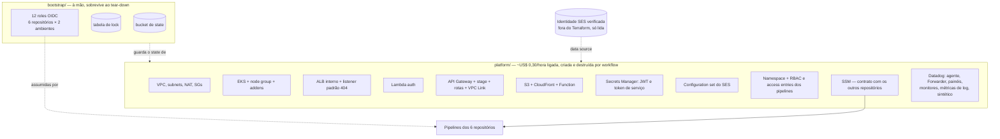
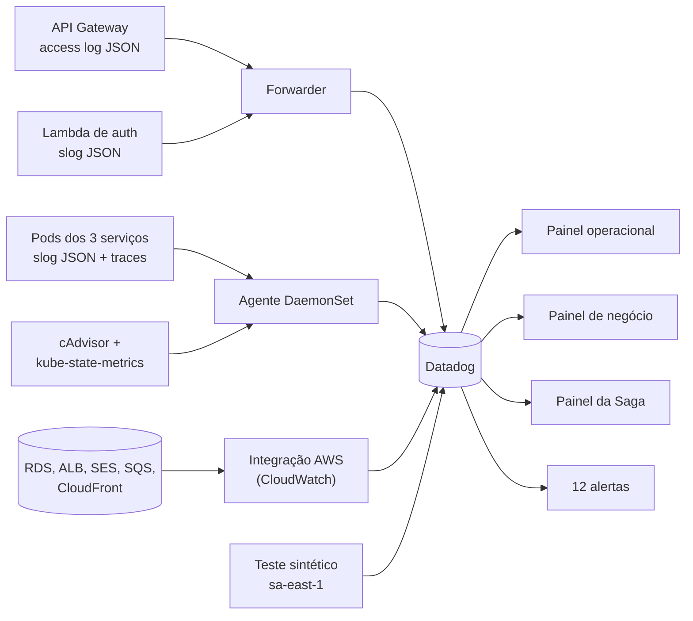

# oficina-mecanica-infrastructure

Provisiona a **plataforma compartilhada** do sistema de gestão de oficina
mecânica: rede, cluster, borda, autenticação e observabilidade. Desde a Fase 4
cada microsserviço cria o próprio banco, filas, IRSA, ECR e manifestos no
repositório dele ([ADR-0017](docs/adr/0017-infra-e-manifestos-no-repositorio-do-servico.md));
este repositório publica no SSM o que eles consomem.

Este é também o repositório que documenta a **arquitetura do sistema completo** —
os READMEs dos outros são operacionais e apontam para cá.

## Os repositórios

| Repositório | Responsabilidade | Artefato |
|---|---|---|
| **oficina-mecanica-infrastructure** | plataforma: VPC, EKS, ALB interno, API Gateway, CloudFront, Lambda (a função), IAM dos pipelines, Datadog | *(este)* |
| [oficina-mecanica-os-service](https://github.com/SOAT-15-Oficina/oficina-mecanica-os-service) (ex-`-monolith`) | OS, catálogos, clientes, veículos, usuários; **orquestrador da Saga** | imagem no ECR do serviço |
| [oficina-mecanica-billing-service](https://github.com/SOAT-15-Oficina/oficina-mecanica-billing-service) | orçamento, decisão do cliente, Mercado Pago | imagem no ECR do serviço |
| [oficina-mecanica-execution-service](https://github.com/SOAT-15-Oficina/oficina-mecanica-execution-service) | fila da bancada, diagnóstico e execução (DynamoDB) | imagem no ECR do serviço |
| [oficina-mecanica-serverless](https://github.com/SOAT-15-Oficina/oficina-mecanica-serverless) | `POST /auth/login` e `POST /auth/register`; confere a senha no OS Service | zip da Lambda |
| [oficina-mecanica-frontend](https://github.com/SOAT-15-Oficina/oficina-mecanica-frontend) | Painel web estático | objetos no S3 |

## Documentação da arquitetura

Este repositório é o dono da visão de sistema. A documentação formal — diagramas,
RFCs, ADRs e o modelo de dados — vive em [`docs/`](docs/):

| | |
|---|---|
| [Índice completo](docs/README.md) | como o conjunto se organiza |
| [Componentes](docs/diagramas/componentes.md) | visão de nuvem: borda, VPC, APIs, banco, observabilidade |
| [Sequência — autenticação](docs/diagramas/sequencia-autenticacao.md) | login, emissão do JWT e consumo de rota protegida |
| [Sequência — ordem de serviço](docs/diagramas/sequencia-ordem-de-servico.md) | portas de entrada de cada ator; o fluxo da Saga está na [RFC-0006](docs/rfc/0006-microsservicos-e-saga.md) |
| [Implantação](docs/diagramas/implantacao.md) | onde cada artefato roda e quem faz o deploy |
| [Modelo de dados](docs/banco-de-dados.md) | justificativa do banco, ER, relacionamentos e ajustes |
| [RFCs](docs/README.md#rfcs--propostas-técnicas) | nuvem, banco, autenticação, observabilidade, repositórios, microsserviços e Saga |
| [ADRs](docs/README.md#adrs--decisões-arquiteturais) | 18 decisões |

O restante deste README é **operacional**: o que este repositório provisiona e
como operá-lo.

## Arquitetura



**EKS, ALB, RDS e o bucket S3 são inalcançáveis de fora.** A única porta pública
é o API Gateway; o bucket só aceita o CloudFront, via Origin Access Control.
Componentes, mensageria e fronteiras de rede em detalhe:
[docs/diagramas/componentes.md](docs/diagramas/componentes.md).

### Caminho de uma requisição

```
Navegador → CloudFront ─┬─ /*      → S3 (painel)
                        └─ /api/*  → API Gateway ─┬─ POST /auth/*  → Lambda → ALB → OS Service (/internal/*)
                                                  └─ $default → VPC Link → ALB interno ─┬─ /billing/*   → Billing
                                                                                        ├─ /execution/* → Execution
                                                                                        └─ /*           → OS Service
```

Uma **CloudFront Function** remove o prefixo `/api` antes de repassar à origem.
Por isso o OS Service serve `/customers`, o Billing `/billing/...` e a Lambda
`/auth/login`, sem saber que existe um `/api` na frente — e o painel, servido da
mesma origem, não precisa de CORS nem de URL de API configurada no build.

O listener do ALB nasce com ação padrão `fixed-response` 404. Cada serviço
pendura nele, pelo próprio Terraform, um target group e uma regra de caminho, e
o pod entra no target group por um `TargetGroupBinding` no `k8s/` do serviço.

## Arquitetura deste repositório

Os diretórios Terraform e o que cada um possui:



O bootstrap guarda o que não pode nascer nem morrer com o ambiente: o backend e
as roles que os workflows assumem para criá-lo. Todo o resto vive numa camada
só, que sobe com o `bring-up` e desce inteira com o `tear-down` — o racional
está na [ADR-0018](docs/adr/0018-camada-unica-de-terraform.md), que substituiu
as duas camadas da [ADR-0006](docs/adr/0006-duas-camadas-de-terraform.md). Na
Fase 4 o banco e o workload de cada serviço foram para o repositório dele
([RFC-0006, seção 9](docs/rfc/0006-microsservicos-e-saga.md#9-infraestrutura-por-repositório)).

## Deploy ativo e contratos de API

Este repositório não expõe API própria. Ele **cria** a porta pública e publica a
URL da API (CloudFront + `/api`) no SSM; o painel fica na raiz do mesmo domínio
(`public_domain`). **O domínio muda a cada bring-up**, e o `bring-up.yml`
imprime no resumo do run as URLs do ambiente que acabou de subir:

```bash
aws ssm get-parameter --name /oficina-mecanica/homolog/public_base_url \
  --query Parameter.Value --output text
```

| | |
|---|---|
| Produção | `/oficina-mecanica/prod/public_base_url` |
| Homologação | `/oficina-mecanica/homolog/public_base_url` |
| Swagger do OS Service | `<URL_PUBLICA>/api/swagger` |
| Swagger do Billing | `<URL_PUBLICA>/api/billing/swagger` |
| Swagger do Execution | `<URL_PUBLICA>/api/execution/swagger` |
| Webhook do Mercado Pago | `<URL_PUBLICA>/api/billing/webhooks/mercadopago` — recadastrar no painel do Mercado Pago a cada subida |
| Contrato de `/auth/*` | [fonte](https://github.com/SOAT-15-Oficina/oficina-mecanica-serverless/blob/main/docs/openapi.yaml) |

Com o ambiente desligado não há domínio: a distribuição do CloudFront é
destruída no `tear-down`.

## Camada única de Terraform

| Diretório | Custo | Conteúdo |
|---|---|---|
| `bootstrap/` | centavos | bucket de state, tabela de lock e as 12 roles de deploy; aplicado à mão e nunca destruído |
| `platform/` | ~US$ 0,30/hora ligada, zero desligada | VPC, NAT, EKS, ALB interno, Lambda, API Gateway, CloudFront e S3, segredos do JWT e do token de serviço, configuration set do SES, SSM, Datadog |
| `infra/` de cada serviço | dois RDS e DynamoDB sob demanda | banco, filas e tópico, IRSA, ECR, segredos, target group e regra no listener |

Ficaram de fora do ciclo, de propósito:

- **As roles de deploy**, no `bootstrap/`: o `bring-up.yml` assume a de
  infraestrutura para aplicar `platform/`, então ela não pode nascer ali. As
  permissões delas sobre recursos da plataforma são escritas por nome (bucket
  `oficina-mecanica-<ambiente>-frontend`, segredos, função), porque esses
  recursos são recriados a cada ciclo.
- **A identidade SES**: destruí-la a remove da conta, e recriá-la exige que
  alguém clique num link de verificação. `platform/` só a lê (data source) e
  para o apply se ela não estiver verificada.

O que entrou no ciclo tem custo conhecido: a URL pública muda a cada subida, o
webhook do Mercado Pago precisa ser recadastrado, os painéis e monitores do
Datadog são recriados e o bring-up e o tear-down ficam mais longos (o
CloudFront leva ~15-25 min para ser desabilitado e removido). Os segredos têm
`recovery_window_in_days = 0`, para o próximo bring-up recriar o mesmo nome.

## Dois ambientes

**Homologação** e **produção** são a mesma stack aplicada duas vezes, na mesma
conta AWS. O que as separa é o valor de `var.environment`, que prefixa cada nome
de recurso (`oficina-mecanica-homolog-*` × `oficina-mecanica-prod-*`), cada
parâmetro do SSM e cada role.

| | homologação | produção |
|---|---|---|
| Branch | `hml` | `main` |
| GitHub Environment | `homolog` | `production` |
| Prefixo no SSM | `/oficina-mecanica/homolog` | `/oficina-mecanica/prod` |
| State (mesmo bucket) | `homolog/platform/terraform.tfstate` | `prod/platform/terraform.tfstate` |
| Roles OIDC | `oficina-mecanica-homolog-gha-*` | `oficina-mecanica-prod-gha-*` |
| Identidades SES | lê as da conta | lê as da conta |

**A branch é a única fonte da verdade.** Nenhum workflow de aplicação tem input
de ambiente: `ci.yml` e `destroy.yml` derivam tudo de `github.ref_name`. O
`bring-up` e o `tear-down` têm input — são manuais e não têm branch implícita —
mas abortam se ele não bater com o ref de onde foram disparados. E a trust
policy do OIDC repete a mesma regra do lado da AWS: a role de homologação só
aceita `ref:refs/heads/hml` e `environment:homolog`. Um push em `hml` não obtém
credencial de produção nem trocando o ARN do secret.

### Por que a mesma conta

Isolamento por nomeação e IAM, não por fronteira de conta. Duas contas dariam
blast radius e billing separados, mas exigiriam um segundo bootstrap, um segundo
provider OIDC e **reverificar o e-mail no SES da conta nova** — que é justamente
o passo manual que manter a identidade fora do Terraform existe para evitar.

O preço dessa escolha são recursos que pertencem à **conta**, e não ao
ambiente. A identidade SES é endereçada pelo próprio e-mail e fica fora do
Terraform: os dois ambientes só a leem, o que funciona porque a policy IRSA dos
serviços usa `resources = ["*"]`. Cada ambiente tem o próprio *configuration
set*, então as métricas de envio não se misturam. A integração AWS e as
métricas de log do Datadog também são da conta: só produção as cria
(`manage_datadog_aws_integration`, `manage_datadog_logs_metrics`).

Rodando à mão, **o backend e o var-file precisam apontar para o mesmo
ambiente**:

```bash
terraform -chdir=platform init -backend-config=homolog.s3.tfbackend
terraform -chdir=platform apply -var-file=../homolog.tfvars
```

Um `init` sem `-backend-config` pergunta a `key`; com `-input=false` (como no CI)
ele falha. Os dois comportamentos são melhores que herdar um state por engano.

## Ciclo de vida

```bash
cd bootstrap && AWS_PROFILE=esantana terraform init && terraform apply
terraform -chdir=bootstrap output github_role_arns
```

O bootstrap cria as roles dos dois ambientes de uma vez; o ARN de cada uma vai
como `AWS_DEPLOY_ROLE_ARN` no GitHub Environment correspondente de cada
repositório. Depois, tudo por workflow:

| Workflow | Gatilho | O que faz |
|---|---|---|
| `terraform.yml` | PR e push → `main` ou `hml` | actionlint, fmt, validate e tflint em `bootstrap/` e `platform/`; não aplica nada |
| `bring-up.yml` | manual, input `environment` | apply de `platform/` → Billing e Execution em paralelo → OS Service → serverless e frontend → URLs e webhook no resumo do run |
| `tear-down.yml` | manual (`environment` + confirmação) | `destroy.yml` do OS Service → Billing e Execution em paralelo → destroy de `platform/` → **verifica que nada sobrou** |
| `destroy.yml` (em cada serviço) | manual ou pelo `tear-down` | `kubectl delete` do overlay, se o cluster existir, e `terraform destroy` do `infra/` |

`bring-up` e `tear-down` precisam ser disparados da branch do ambiente: `hml`
para homologação, `main` para produção. O código que sobe um ambiente é o código
promovido para ele — o workflow aborta antes de tocar na AWS se o par não bater.
O disparo entre repositórios usa o secret `CROSS_REPO_DISPATCH_TOKEN`, que
precisa de `actions:write` nos repositórios dos serviços.

O OS Service sai primeiro porque as assinaturas da `os-inbox` ficam nos tópicos
de Billing e Execution. A plataforma sai por último porque o `infra/` de cada
serviço lê dela, pelo SSM, a VPC e o listener — destruir a plataforma antes
deixaria o `terraform destroy` dos serviços sem como ler a configuração.

O `bring-up` leva ~35-45 min do zero até demonstrável e o `tear-down`, ~30-45
min. **Ensaie uma vez antes de valer**, e não descubra no dia — e é para isso
que homologação existe.

Os dois ambientes sobem e descem de forma independente: a chave de `concurrency`
inclui o nome do ambiente, então mexer em homologação não segura produção na
fila. Subir e derrubar o *mesmo* ambiente continuam serializados.

## Observabilidade

Implementada com **Datadog**, pela razão que a
[RFC-0004](docs/rfc/0004-estrategia-de-observabilidade.md) isola: painel e
alerta são recursos de Terraform como qualquer outro, e são recriados iguais a
cada `bring-up`. New Relic segue registrado como alternativa — a
instrumentação não mudaria, só as definições de painel.

Tudo vive em `platform/` e nasce e morre com o ambiente:

| Arquivo | O que define |
|---|---|
| `platform/datadog.tf` | chave no Secrets Manager, integração AWS, Forwarder de logs, contrato no SSM |
| `platform/datadog_metrics.tf` | métricas geradas a partir dos eventos de domínio no log |
| `platform/datadog_dashboard_operacional.tf` · `_negocio.tf` · `_saga.tf` | os três painéis |
| `platform/datadog_monitors.tf` · `datadog_monitors_saga.tf` | os nove alertas da Fase 3 e os três da Saga |
| `platform/datadog_agent.tf` | agente no cluster + assinatura do log da Lambda |
| `platform/datadog_synthetics.tf` | teste sintético de `/api/ping` |
| `platform/apigateway_routes.tf` | *parameter mapping* que injeta `$context.requestId` como header |
| `k8s/` de cada serviço | `DD_ENV`/`DD_SERVICE`, `DD_AGENT_HOST` e as tags do pod |

### De onde vem cada sinal



Os dois caminhos existem porque nenhum sozinho cobre tudo: o agente enxerga o
que roda **dentro** do cluster, a integração AWS e o Forwarder enxergam o que
está **fora** dele. O access log do API Gateway está no segundo grupo, e é ele
que carrega o `requestId` que a aplicação recebe como `X-Request-Id` — sem o
Forwarder, o rastro de uma requisição começa já depois da borda.

### Os dois painéis

**Operacional** — uptime visto de fora, latência da borda e da aplicação
(p50/p95/p99 por rota), respostas por classe de status, CPU e memória por pod
contra os limites, réplicas do HPA contra o teto, pods por fase, reinícios,
Lambda, RDS e um stream dos erros recentes.

**Negócio** — os três que o enunciado da fase nomeia:

| Painel | Como se calcula |
|---|---|
| Volume diário de ordens de serviço | `sum:oficina.work_order_created` — conferível contra `SELECT date(received_at), COUNT(*) FROM work_orders GROUP BY 1` |
| Tempo médio de execução por status | `avg:oficina.work_order_stage_duration by {to}`, mais o p95 ao lado |
| Erros e falhas nas integrações | `oficina.integration_error by {integration}`, mais 5xx do gateway, erros da Lambda e bounces do SES |

Os três saem de **métricas de log**, e não de consulta a log: o Datadog conta o
evento na ingestão e guarda só o número, com retenção de métrica (15 meses) em
vez de retenção de log (dias). O log continua lá para a investigação.

**Saga** — eventos `saga.*` por tipo (métrica de log `oficina.saga_event`),
mensagens visíveis e idade da mais antiga em cada `*-inbox.fifo`, profundidade
das `*-inbox-dlq.fifo` e o stream dos logs da Saga com `@saga_id`,
`@work_order_id` e `@message_type`.

Os serviços do Datadog são `os-service`, `billing-service`, `execution-service`
e `auth-lambda`. Os painéis e alertas de RDS agrupam por instância
`oficina-<ambiente>-*`, porque OS e Billing têm cada um o seu banco.

### Os alertas

Nove da tabela da RFC-0004 e três da Saga (RFC-0006, seção 11). O primeiro é
o exigido nominalmente pela Fase 3:

| Alerta | Condição | Prioridade |
|---|---|---|
| **Falha no processamento de OS** | `@event:work_order.transition_rejected` ou `ERROR` com `@work_order_id` em 5 min | 2 |
| Falha no envio de orçamento | ≥ 1 `@event:budget.send_failed` em 15 min | 2 |
| API pública indisponível | `/api/ping` falhando em 2 verificações seguidas | 1 |
| Latência degradada | p95 > 1s por 10 min | 3 |
| Taxa de 5xx | > 1% das requisições em 5 min | 2 |
| HPA no teto | réplicas = 10 por 15 min | 3 |
| Pod reiniciando | ≥ 3 reinícios em 15 min | 3 |
| Conexões do banco | > 80% de `max_connections` | 2 |
| Espaço livre do RDS | < 20% | 4 |
| **Mensagem da Saga em DLQ** | qualquer `*-inbox-dlq.fifo` com mensagem visível | 2 |
| Inbox da Saga com mensagem antiga | mensagem mais antiga de uma `*-inbox.fifo` > 5 min | 2 |
| Erro na Saga | log `status:error @event:saga.*` em 5 min | 2 |

Duas regras valem para todos, e as duas são consequência do ambiente subir e
descer:

- **`notify_no_data = false`.** Ausência de dado é o estado *normal* de um
  ambiente desligado. Alertar sobre isso treina o time a ignorar alerta.
- **A query pergunta por evento nomeado, nunca por texto de mensagem.**
  `@event:budget.send_failed` sobrevive à refatoração; `msg:"falha ao enviar"`
  quebra nela.

Existe um décimo alerta — "agente sem reportar", o único que dispara *na*
ausência de dado, cobrindo o silêncio dos outros. Fica desligado por padrão
(`datadog_alert_on_missing_agent`) justamente porque dispararia em todo
`tear-down`.

### O que a aplicação precisa emitir

Tudo acima consulta campos do JSON do `slog`, na taxonomia da
[ADR-0011](docs/adr/0011-logs-estruturados-com-correlacao.md). **Enquanto o
serviços e a Lambda não os emitirem, as métricas existem e ficam em zero** — que
é o estado correto, e não uma falha de configuração. Os da Saga dependem de
`@event:saga.*` nos logs do OS Service.

O `slog` das duas aplicações está em PR aberto:
[monolith#4](https://github.com/SOAT-15-Oficina/oficina-mecanica-monolith/pull/4)
e
[serverless#4](https://github.com/SOAT-15-Oficina/oficina-mecanica-serverless/pull/4).
O elo do lado da borda — o *parameter mapping* que injeta `$context.requestId`
como header — mora aqui, em `platform/apigateway_routes.tf`.

| Campo | Quem consome |
|---|---|
| `@event` | métricas de negócio e os dois alertas de log |
| `@env`, `@service` | separação entre homologação e produção em todo painel |
| `@request_id` | correlação com o access log do gateway |
| `@duration_ms` + `@route` + `@status` | latência por rota e taxa de erro |
| `@duration_ms` + `@from` + `@to` (em `work_order.status_changed`) | tempo médio por status |
| `@integration` (em `status:error`) | painel de falhas de integração |
| `@work_order_id` | alerta de falha no processamento |
| `@event:saga.*`, `@saga_id`, `@message_type` | painel e alerta da Saga |

### Ligar num ambiente

`DATADOG_API_KEY` e `DATADOG_APP_KEY` são secrets de **GitHub Environment**
(`production` e `homolog`), ao lado de `AWS_DEPLOY_ROLE_ARN`. **Os quatro já
existem, com o valor de espera `REPLACE_ME_…`** — falta criar a conta e
substituí-los:

```bash
gh secret set DATADOG_API_KEY --repo SOAT-15-Oficina/oficina-mecanica-infrastructure \
  --env production --body "<chave de API>"
gh secret set DATADOG_APP_KEY --repo SOAT-15-Oficina/oficina-mecanica-infrastructure \
  --env production --body "<chave de aplicação>"
```

São coisas diferentes: a de API (*Organization Settings → API Keys*) autoriza
**enviar** dado e é a que vai para o Secrets Manager, lida pelo agente e pelo
Forwarder; a de aplicação (*Organization Settings → Application Keys*) autoriza
**escrever configuração** — painel, monitor, integração — e só o Terraform a usa.

O `bring-up.yml` aborta **antes do plano** em dois casos: quando as chaves faltam e quando
elas ainda carregam o `REPLACE_ME`. O segundo teste existe porque um secret
preenchido com placeholder é ausência disfarçada: sem ele o guard-rail passaria
e o `apply` só quebraria ao falar com a API do Datadog, depois de já ter criado
o segredo no Secrets Manager e a stack do Forwarder.

Falhar aqui, e não cair em `datadog_enabled = false`, é deliberado: subir sem
observabilidade em silêncio tiraria do ambiente parte do que ele existe para
demonstrar.

A variable `TF_VAR_DATADOG_SITE` existe no repositório com `datadoghq.com`.
Mude-a se a organização for de outra região (uma conta criada na UE é
`datadoghq.eu`). **Errar isso não dá erro visível**: o agente sobe, envia para o
site errado e os painéis ficam vazios.

Para subir o ambiente sem Datadog, a variable `TF_VAR_DATADOG_ENABLED=false`.
O `tear-down.yml` usa os mesmos valores: sem as chaves ele não consegue remover
o que o Datadog criou.

**A integração AWS pertence à conta, não ao ambiente** — mesma armadilha das
identidades do SES. Só produção a cria (`manage_datadog_aws_integration`);
homologação não perde nada, porque as métricas chegam com a tag `env` de cada
recurso.

## Decisões que a estrutura carrega

### O ALB é do Terraform, não de um Ingress

A integração VPC Link do HTTP API aponta para o **ARN de um listener**. Se o ALB
nascesse de um `Ingress`, quem o criaria seria o AWS Load Balancer Controller, de
forma assíncrona — e o ARN não existiria no `plan`, exigindo descoberta por tag
com retry ou um apply em duas fases.

Então o Terraform cria `aws_lb` (internal) + listener com ação padrão 404, e
publica o ARN do listener no SSM (`alb_listener_arn`). Cada serviço cria no
próprio `infra/` um target group (`target_type = ip`) e uma regra de caminho, e
o controller entra apenas pelo CR **`TargetGroupBinding`** do `k8s/` do serviço,
mantendo o target group populado com os IPs dos pods conforme o HPA escala.

Efeito colateral valioso: como o Terraform é dono do ALB, o `destroy` remove na
ordem certa — e o problema clássico de **ENI órfã travando a deleção da subnet**
(o maior risco de um ambiente efêmero) deixa de existir.

### Terraform é dono da forma; o CD é dono do artefato

A `aws_lambda_function` é recurso deste repositório, criada com um zip
placeholder que responde 503 e `lifecycle.ignore_changes` no código: VPC,
memória, timeout, role e variáveis de ambiente são daqui; o zip é do pipeline
do `-serverless`. Os workloads dos serviços saíram daqui: Deployment, Service,
HPA e PDB são YAML no `k8s/` de cada repositório
([ADR-0017](docs/adr/0017-infra-e-manifestos-no-repositorio-do-servico.md)).

### NAT Gateway, não VPC endpoints

Um cluster sem saída para a internet não consegue puxar as imagens
obrigatórias, e endpoint de ECR não dá acesso a registry público:

| Imagem | Origem |
|---|---|
| `registry.k8s.io/metrics-server/...` | necessário para o HPA |
| `public.ecr.aws/eks/aws-load-balancer-controller` | quem popula o target group |

Sem NAT, o `bring-up` morre em `ImagePullBackOff` justamente no controller. O
**gateway endpoint do S3** entra porque é gratuito e tira do NAT o maior volume
de tráfego (as camadas de imagem do ECR são servidas pelo S3).

### Contrato entre repositórios via SSM

Os pipelines de aplicação não têm acesso ao bucket de state da plataforma (que
contém segredos). Leem daqui:

| Parâmetro | Consumidor |
|---|---|
| `eks_cluster_name`, `eks_cluster_endpoint`, `kube_namespace` | os três serviços |
| `vpc_id`, `private_subnet_ids` | `infra/` dos serviços (banco, target group) |
| `eks_oidc_provider_arn` | trust policy da role IRSA de cada serviço |
| `eks_node_security_group_id` | SG do RDS de cada serviço libera a 5432 para os pods |
| `alb_listener_arn` | regra de caminho de cada serviço no ALB interno |
| `alb_dns_name` | diagnóstico; a Lambda recebe `OS_INTERNAL_BASE_URL` direto do Terraform |
| `public_base_url` | `APP_BASE_URL` dos serviços: CloudFront + `/api`, base dos links por e-mail |
| `jwt_secret_arn` | Lambda e os três serviços |
| `internal_service_token_secret_arn` | Lambda e OS Service |
| `auth_lambda_name` | serverless |
| `frontend_bucket_name`, `cloudfront_distribution_id`, `public_domain` | frontend |

Dentro de `platform/` não há mais contrato por SSM: a Lambda, as rotas do
gateway e o agente do Datadog referenciam os recursos diretamente.

`eks_node_security_group_id` é o **security group do cluster**
(`eks-cluster-sg-<cluster>`), e não um SG próprio dos nós: um node group sem
launch template ignora SG customizado, e os pods usam IPs secundários da ENI do
nó, então é esse o SG de origem do tráfego que chega ao RDS.

Saíram na Fase 4: `ecr_repository_url` (cada serviço tem o seu ECR),
`api_deployment_name`, `api_service_name`, `database_endpoint`, `database_name`
e `database_secret_arn` (a plataforma não tem mais banco nem workload). Cada
serviço publica os próprios parâmetros com o prefixo do nome dele
(`billing_*`, `execution_*`, `os_*`).

Prefixo: `/oficina-mecanica/<ambiente>/` — `prod` ou `homolog`. Os pipelines o
montam a partir da branch; nenhum deles carrega o nome de um ambiente fixo.

### Token de serviço

O OS Service expõe `POST /internal/credentials/verify` e `POST /internal/users`
para a Lambda, protegidos pelo header `X-Service-Token`. O segredo
`oficina-mecanica/<ambiente>/internal-service-token` **nasce em `platform/`**,
como o do JWT, e tem dois leitores: a Lambda (por
`INTERNAL_SERVICE_TOKEN_SECRET_ID`) e o OS Service (o pipeline dele lê o ARN em
`internal_service_token_secret_arn` e materializa o valor em
`INTERNAL_SERVICE_TOKEN`). Ele não depende da ordem de deploy dos serviços, é
regerado a cada bring-up, e girar o valor no meio de um ciclo é um `taint` do
`random_password` seguido de um redeploy dos dois leitores.

### Autenticação dos pipelines

**OIDC**, sem access key em lugar nenhum. Uma role por repositório, com o mínimo:

| Role | Pode |
|---|---|
| `gha-os-service`, `gha-billing-service`, `gha-execution-service` | aplicar o próprio `infra/` (state em `<ambiente>/<repo>/`, ECR, filas e tópico, RDS ou DynamoDB, role IRSA, segredos e parâmetros com o nome do serviço, target group e regras no listener da plataforma), ler o segredo do JWT, e editar o namespace `workshop` (inclui `TargetGroupBinding`); o OS também lê o token de serviço e assina a `os-inbox` nos tópicos dos outros dois |
| `gha-serverless` | `lambda:UpdateFunctionCode` numa função específica |
| `gha-frontend` | escrever num bucket específico, invalidar distribuições do CloudFront da conta (o ID muda a cada bring-up) |
| `gha-infrastructure` | admin — é quem cria e destrói `platform/`; o freio é o required reviewer |

São **seis roles por ambiente**, criadas pelo `bootstrap/` — os nomes acima são o sufixo de
`oficina-mecanica-<ambiente>-`. Cada role confia apenas em workflows do seu
repositório, na branch daquele ambiente (`main` para produção, `hml` para
homologação) ou sob o GitHub Environment correspondente.

O `-monolith` foi renomeado para `-os-service` no GitHub, e o ID numérico do
repositório sobrevive ao rename: o `sub` imutável continua valendo com o mesmo
ID. Os seis IDs estão em `github_repository_ids` (`bootstrap/variables.tf`);
um repositório sem ID aceitaria só o formato clássico do `sub`.

A role de deploy dos serviços cria roles IAM com política inline, restrita ao
prefixo `oficina-<ambiente>-<serviço>`; não pode anexar política gerenciada. O
próximo passo de endurecimento é um *permissions boundary* obrigatório nessas
roles. As mesmas permissões cobrem o `destroy.yml` de cada serviço: toda ação
de criação da lista tem a de remoção correspondente.

`AWS_DEPLOY_ROLE_ARN` é um **secret de GitHub Environment**, não de repositório:
os dois ambientes usam o mesmo nome e só o escopo do Environment os separa. Em
cada um dos repositórios, nos Environments `production` e `homolog`, com os
valores do output `github_role_arns` do `bootstrap/`. `AWS_REGION`
continua sendo uma variable de repositório — a região é a mesma nos dois.

Trocar dois ARNs entre si dá `AccessDenied` ao assumir: a trust policy amarra
cada role ao nome do repositório **e** ao ambiente.

### E-mail

O OS Service (status ao cliente) e o Billing (orçamento e link de pagamento)
enviam pela **API do SES v2 via IRSA**: cada pod assume a role do próprio
serviço através de um ServiceAccount anotado, e não existe credencial estática
em lugar nenhum. **Homologação e produção enviam pelo SES, sem exceção**; o
`mailhog` existe apenas no `local/docker-compose.local.yml`.

A conta tem **acesso de produção concedido** no SES (`sa-east-1`), com cota de
50.000 e-mails/24h a 14/segundo — a fila de sandbox (200/24h, 1/s, só
destinatários verificados) não se aplica mais. Entrega para qualquer
destinatário; o que continua exigindo verificação é o **remetente**
(`var.ses_sender_email`), e um `MessageRejected` ainda é possível — remetente
não verificado, destinatário em lista de supressão, conta pausada.

Verificar um remetente **não é automatizável** — o endereço recebe um link que
alguém precisa clicar. Por isso a identidade fica fora do Terraform: `platform/`
só a lê, e o apply para se ela não estiver verificada.

> **Consequência de sair do sandbox:** homologação também passou a alcançar
> caixas reais. O sandbox era, na prática, uma rede de proteção contra e-mail de
> teste chegando a cliente de verdade; ela não existe mais. Use dados de
> exemplo com endereços controlados em `hml`.

Cada ambiente tem o próprio *configuration set* (`oficina-mecanica-homolog` e
`oficina-mecanica-prod`), então as métricas de envio não se misturam.

### Segredos

Na plataforma ficam dois segredos de aplicação, ambos gerados por
`random_password` em `platform/` e recriados a cada bring-up: o **JWT** (`oficina-mecanica-<ambiente>/jwt-secret`,
assinado pela Lambda e validado pelos três serviços) e o **token de serviço**
(`oficina-mecanica/<ambiente>/internal-service-token`, Lambda e OS Service). A
credencial de cada banco é gerada pelo `infra/` do serviço dono dele.

**Consequência assumida:** o valor em claro passa pelo `tfstate`. Por isso o
bucket de state tem versionamento, SSE e uma policy que nega qualquer acesso
fora de TLS — e por isso a role de infraestrutura é a única que lê o state da
plataforma.

A **chave de API do Datadog** segue o mesmo caminho, e por um motivo concreto: o
agente dentro do cluster precisa lê-la em tempo de execução, e o Forwarder a lê
direto do ARN. Ela entra por `TF_VAR_datadog_api_key` (secret do GitHub
Environment) e nunca aparece em `values` do Helm — o chart recebe o *nome* de um
`Secret` já existente, porque valor passado por `--set` fica legível no release
para qualquer um com acesso ao namespace.

A **chave de aplicação** (`datadog_app_key`) é outra coisa: ela autoriza ler e
escrever *configuração* — painel, monitor, integração. Só o Terraform a usa, e
ela não entra no cluster.

## Desenvolvimento local

```bash
docker compose -f local/docker-compose.local.yml up --build
# http://localhost:8080   painel + API
# http://localhost:8025   MailHog (substitui o SES)
# http://localhost:8095   Mercado Pago falso
```

Sobe painel, Lambda, OS Service, Billing, Execution, os dois PostgreSQL,
LocalStack (filas e tópicos FIFO, assinaturas e a tabela DynamoDB), MailHog e o
Mercado Pago falso, atrás de um **nginx que replica o roteamento do CloudFront e
do API Gateway**, inclusive a remoção do prefixo `/api`. URLs, valores fixos e
como simular o pagamento: [`local/README.md`](local/README.md).

Para trabalhar em um repositório isolado, cada um tem seu próprio
`docker-compose.yml`.

## Custo

| | |
|---|---|
| Desligado | ~US$ 0: só o bucket de state e a tabela de lock do `bootstrap/` |
| `platform/`, ligada | ~US$ 0,28/hora (EKS US$ 0,10 + 2× t3.medium + NAT + ALB) |
| Serviços, ligados | dois RDS `db.t4g.micro` (OS e Billing); DynamoDB, SQS e SNS sob demanda |
| Datadog | trial de 14 dias sem cartão; depois, por host e por GB de log ingerido |

Uma janela de uso de 4 horas custa cerca de **US$ 1,20**.

O Datadog é a única peça cujo custo **não** está dimensionado aqui, e é
deliberado: a cobrança é por host ativo e por GB ingerido, e o ambiente só fica
de pé em janelas curtas. As duas decisões que seguram o número estão no código,
não numa política — `namespace_filters` restringe a coleta do CloudWatch aos
seis namespaces que os painéis leem (`platform/datadog.tf`), e os contadores
de negócio são **métricas de log**, que guardam o número e descartam a linha
(`platform/datadog_metrics.tf`).

Homologação é efêmera pelo mesmo motivo que produção: mantê-la de pé 24/7
custaria ~US$ 200/mês, mais que o ambiente que ela existe para proteger.
Desligados, os dois ambientes não custam nada além do bucket de state.
