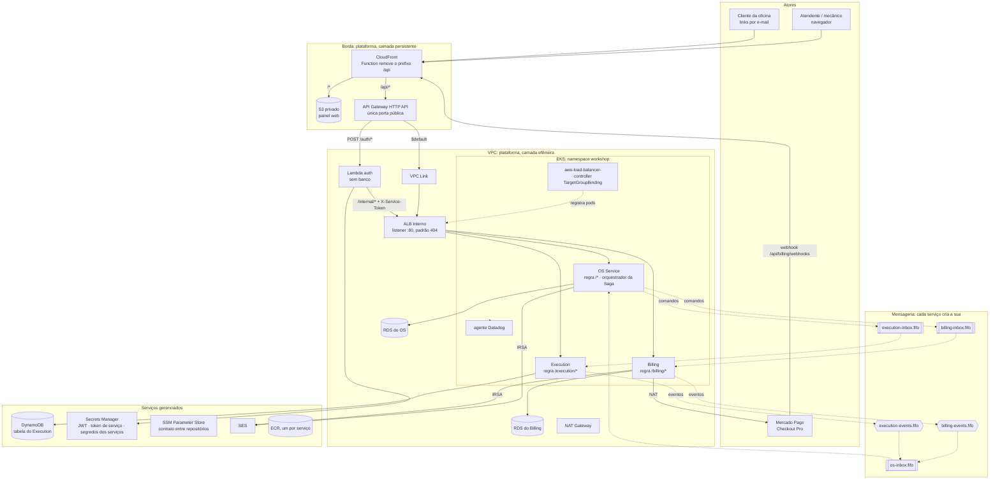

# Diagrama de componentes

Visão de nuvem da Fase 4: borda, rede privada, os três microsserviços, a
mensageria da Saga, serviços gerenciados e observabilidade. O desenho e o
racional estão na [RFC-0006](../rfc/0006-microsservicos-e-saga.md).

Como ler o diagrama: setas cheias são caminho de requisição ou de dado; setas
pontilhadas são mensagens assíncronas, relações de controle e telemetria. A
plataforma ([ADR-0017](../adr/0017-infra-e-manifestos-no-repositorio-do-servico.md))
é tudo o que este repositório cria; o que fica dentro de cada serviço nasce no
`infra/` e no `k8s/` do repositório dele.

## Quem é dono de quê

| Componente | Repositório dono | Artefato |
|---|---|---|
| CloudFront, S3, API Gateway e stage, Secrets Manager do JWT e do token de serviço, SSM estável, SES, IAM/OIDC dos pipelines, painéis e monitores do Datadog | `oficina-mecanica-infrastructure` (`persistent/`) | recursos AWS |
| VPC, NAT, EKS, namespace, ALB interno e listener, ALB Controller, Metrics Server, agente Datadog, Lambda (a função), VPC Link, rotas do API Gateway | `oficina-mecanica-infrastructure` (`ephemeral/`) | recursos AWS e Kubernetes |
| RDS do OS, `os-inbox` e assinaturas nos tópicos, role IRSA, ECR, regra `/*`, Deployment e afins | `oficina-mecanica-os-service` (`infra/`, `k8s/`) | imagem no ECR próprio |
| RDS do Billing, `billing-inbox`, `billing-events`, role IRSA, ECR, regra `/billing/*`, Deployment e afins | `oficina-mecanica-billing-service` | imagem no ECR próprio |
| Tabela DynamoDB, `execution-inbox`, `execution-events`, role IRSA, ECR, regra `/execution/*`, Deployment e afins | `oficina-mecanica-execution-service` | imagem no ECR próprio |
| Código da Lambda de autenticação | `oficina-mecanica-serverless` | zip publicado na função |
| Painel web estático | `oficina-mecanica-frontend` | objetos no S3 |

O listener do ALB nasce com ação padrão `fixed-response` 404: até o OS Service
criar a regra `/*`, toda rota que não é `/auth/*` responde 404. A ordem das
regras é dada pela prioridade que cada serviço escolhe (Billing e Execution
abaixo do número do OS, para os prefixos ganharem do curinga).

## Superfície pública

Exatamente um endereço é alcançável da internet: o domínio do CloudFront.

- O bucket S3 só aceita requisições assinadas pelo Origin Access Control.
- O API Gateway expõe `/auth/*` e o `$default`, que vai ao ALB interno. O
  webhook do Mercado Pago entra por esse caminho e é validado pela assinatura
  `x-signature` ([ADR-0016](../adr/0016-mercado-pago-checkout-pro.md)).
- As rotas `/internal/*` do OS Service ficam atrás do mesmo ALB, protegidas
  pelo header `X-Service-Token`; só a Lambda conhece o valor.
- ALB, EKS, RDS e Lambda vivem em subnets privadas, sem IP público.

## Onde cada tráfego anda

| Origem | Destino | Caminho |
|---|---|---|
| Pods dos serviços | RDS do próprio serviço | rede privada; o SG do RDS libera o SG do cluster (`eks_node_security_group_id`) |
| Pods dos serviços | SQS, SNS, DynamoDB, SES, Mercado Pago, ECR | NAT Gateway, com permissão por IRSA |
| Lambda auth | ALB interno (porta 80) | rede privada, SG da Lambda → SG do ALB |
| Lambda auth | Secrets Manager | NAT Gateway (HTTPS) |
| Agente Datadog | backend SaaS | NAT Gateway |
