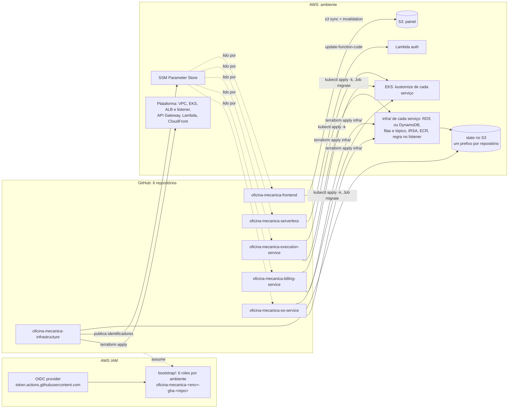
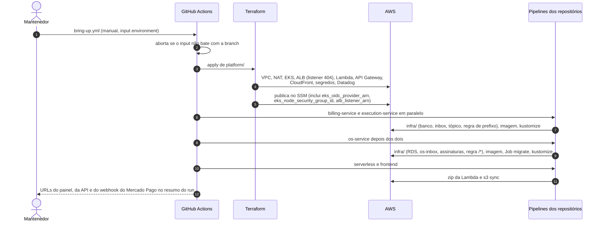
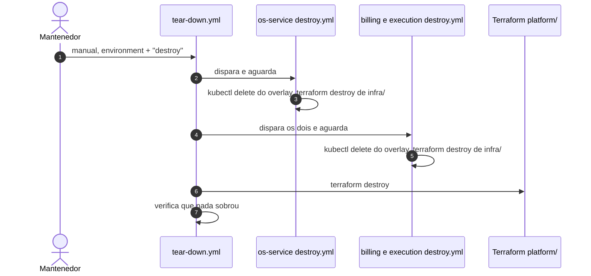

# Implantação e ciclo do ambiente

Onde cada artefato roda, quem o publica e por qual caminho. Na Fase 4 cada
serviço aplica o próprio Terraform (`infra/`) e os próprios manifestos (`k8s/`)
([ADR-0017](../adr/0017-infra-e-manifestos-no-repositorio-do-servico.md)); a
plataforma cria o que é compartilhado e publica no SSM o que eles consomem. As
setas pontilhadas são leitura do contrato no SSM e a relação de confiança do
IAM.

## Bootstrap e camada única de Terraform

| Diretório | Custo | Conteúdo | Aplicação | No tear-down |
|---|---|---|---|---|
| `bootstrap/` | centavos | bucket de state, tabela de lock e as 12 roles de deploy (6 repositórios × 2 ambientes) | à mão, state local versionado | fica |
| `platform/` | ~US$ 0,30/h ligada, zero desligada | VPC, NAT, EKS, namespace e RBAC dos pipelines, ALB interno e listener, add-ons, Lambda, API Gateway com rotas e VPC Link, CloudFront e S3 do painel, segredos do JWT e do token de serviço, configuration set do SES, SSM, Datadog | `bring-up.yml` | destruída |
| `infra/` de cada serviço | dois RDS e DynamoDB sob demanda | banco, filas e tópico, IRSA, ECR, segredo, target group e regra | `ci.yml` do serviço | `destroy.yml` do serviço |

O state de `platform/` fica em `<ambiente>/platform/terraform.tfstate` e o de
cada serviço em `<ambiente>/<repo>/terraform.tfstate`, no mesmo bucket. A
identidade SES do remetente fica fora do Terraform e é só lida, para não exigir
nova verificação por e-mail a cada ciclo. Com o ambiente desligado não existe
domínio público: o CloudFront nasce com um domínio novo a cada bring-up
([ADR-0018](../adr/0018-camada-unica-de-terraform.md)).

## Branch decide ambiente

| Branch | GitHub Environment | Prefixo no SSM | Roles |
|---|---|---|---|
| `hml` | `homolog` | `/oficina-mecanica/homolog` | `oficina-mecanica-homolog-gha-*` |
| `main` | `production` | `/oficina-mecanica/prod` | `oficina-mecanica-prod-gha-*` |

Nenhum workflow de aplicação aceita input de ambiente: o `ref` já carrega a
informação. A regra é repetida do lado da AWS, e a trust policy da role de
homologação só aceita `ref:refs/heads/hml` e `environment:homolog`
([ADR-0008](../adr/0008-oidc-para-os-pipelines.md)). `bring-up` e `tear-down` têm input porque são manuais,
mas abortam se ele não bater com o ref de onde foram disparados.

## Ordem de um ciclo completo

Billing e Execution vão antes do OS Service porque o `infra/` do OS lê do SSM as
filas de entrada e os tópicos de eventos dos dois (`billing_inbox_queue_arn`,
`billing_events_topic_arn`, `execution_inbox_queue_arn`,
`execution_events_topic_arn`) para assinar a `os-inbox` e ganhar permissão de
envio. Até o OS subir, a regra padrão do listener responde 404 e a Lambda não
autentica, porque a tabela `users` mora no banco do OS.

**Tear-down:** o `tear-down.yml` dispara o `destroy.yml` do OS Service, que
remove os objetos do `k8s/` (liberando o `TargetGroupBinding`) e destrói o
`infra/` dele, inclusive as assinaturas da `os-inbox` nos tópicos dos outros
dois; depois o de Billing e o de Execution em paralelo; e por fim destrói
`platform/`. A checagem final procura VPC, Elastic IP, cluster, RDS, tabela
DynamoDB, distribuição CloudFront e parâmetros SSM do ambiente que tenham
sobrado.

## O que cada pipeline faz

| Repositório | Etapas do deploy |
|---|---|
| `oficina-mecanica-os-service`, `-billing-service`, `-execution-service` | `terraform apply` do `infra/`, lê o SSM, `docker build/push` no ECR do serviço, sincroniza o Secret, `kubectl kustomize \| kubectl apply`, Job `migrate` (OS e Billing) |
| `oficina-mecanica-serverless` | lê o nome da função no SSM, publica o zip com `update-function-code`, faz um `invoke` de fumaça |
| `oficina-mecanica-frontend` | lê bucket e id da distribuição no SSM, `s3 sync`, invalidação do CloudFront |

A role de deploy de cada serviço (`bootstrap/oidc_services.tf`) só alcança
recursos com o nome do próprio serviço: o prefixo do state, o ECR
`oficina-mecanica/<ambiente>/<repo>`, filas e tópicos `oficina-<ambiente>-<serviço>-*`,
a role IRSA `oficina-<ambiente>-<serviço>*`, segredos e parâmetros SSM com o
nome do serviço, o target group próprio e as regras do listener da plataforma.
O acesso ao cluster vem de uma access entry por role, com `AmazonEKSEditPolicy`
no namespace e um `Role` que libera `TargetGroupBinding`. As mesmas permissões
cobrem o `destroy.yml`: cada `Create*` da lista tem o `Delete*` correspondente.

| Tempo ou custo | Valor |
|---|---|
| Do zero até um ambiente demonstrável | 35 a 45 minutos (CloudFront e Forwarder do Datadog entram no ciclo) |
| Destruir a distribuição CloudFront | 15 a 25 minutos (precisa ser desabilitada antes) |
| Tear-down completo | 30 a 45 minutos |
| Ambiente ligado | ~US$ 0,30/hora da plataforma, mais os dois RDS dos serviços |
| Ambiente desligado | ~US$ 0 (só o bucket de state e a tabela de lock) |
