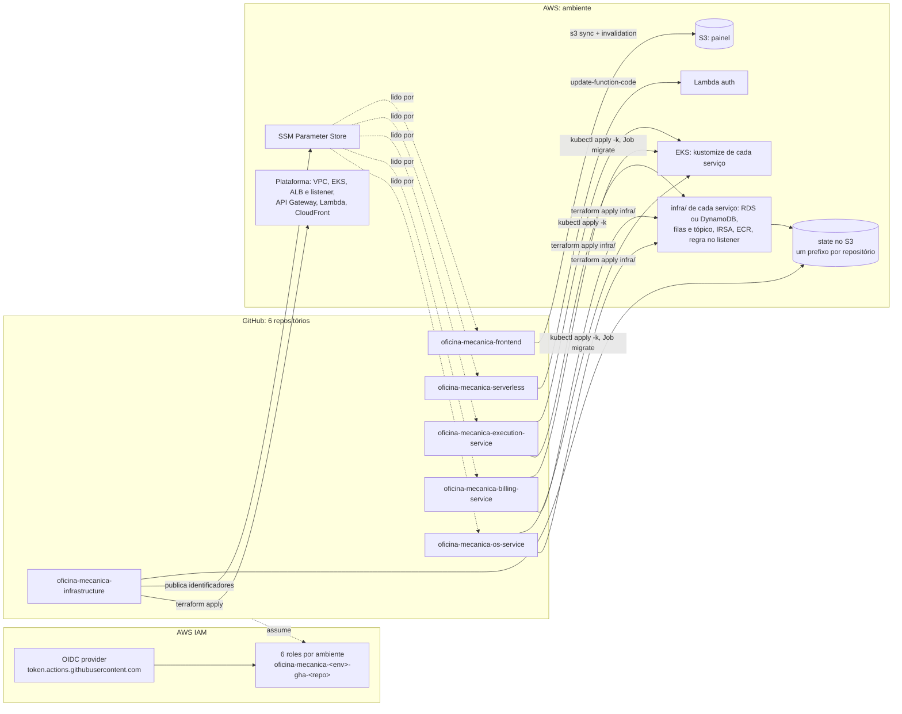
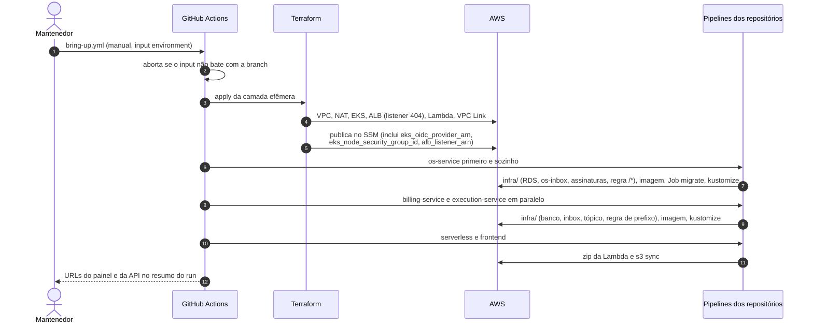

# Implantação e ciclo do ambiente

Onde cada artefato roda, quem o publica e por qual caminho. Na Fase 4 cada
serviço aplica o próprio Terraform (`infra/`) e os próprios manifestos (`k8s/`)
([ADR-0017](../adr/0017-infra-e-manifestos-no-repositorio-do-servico.md)); a
plataforma cria o que é compartilhado e publica no SSM o que eles consomem. As
setas pontilhadas são leitura do contrato no SSM e a relação de confiança do
IAM.

## As duas camadas de Terraform

| Camada | Diretório | Custo | Conteúdo | Aplicação |
|---|---|---|---|---|
| Bootstrap | `bootstrap/` | centavos | bucket de state, tabela de lock | à mão, uma vez por conta |
| Persistente | `persistent/` | ~US$ 1/mês | OIDC e roles dos 6 repositórios, identidades SES, S3, CloudFront, API Gateway e stage, segredos do JWT e do token de serviço, parâmetros SSM estáveis, Datadog | automática, em push para `hml` ou `main` |
| Efêmera | `ephemeral/` | ~US$ 0,30/h | VPC, NAT, EKS, namespace e RBAC dos pipelines, ALB interno e listener, add-ons do cluster, Lambda, VPC Link, rotas e integrações do gateway | manual, por `bring-up.yml` e `tear-down.yml` |

Os serviços têm um terceiro nível: o `infra/` de cada um, com state próprio em
`<ambiente>/<repo>/terraform.tfstate` no mesmo bucket, aplicado pelo pipeline do
serviço depois que a camada efêmera está no ar.

O corte mais fino está no API Gateway: **o API e o stage são persistentes; as
rotas, as integrações e o VPC Link são efêmeros**. Com o ambiente desligado, o
domínio existe e responde 404, que é o comportamento esperado
([ADR-0006](../adr/0006-duas-camadas-de-terraform.md)).

## Branch decide ambiente

| Branch | GitHub Environment | Prefixo no SSM | Roles |
|---|---|---|---|
| `hml` | `homolog` | `/oficina-mecanica/homolog` | `oficina-mecanica-homolog-gha-*` |
| `main` | `production` | `/oficina-mecanica/prod` | `oficina-mecanica-prod-gha-*` |

Nenhum workflow de aplicação aceita input de ambiente: o `ref` já carrega a
informação. A regra é repetida do lado da AWS, e a trust policy da role de
homologação só aceita `ref:refs/heads/hml` e `environment:homolog`
([ADR-0008](../adr/0008-oidc-para-os-pipelines.md)). `bring-up` e `tear-down` têm input porque são manuais,
mas abortam se ele não bater com o ref de onde foram disparados.

## Ordem de um ciclo completo

O OS Service vai primeiro porque cria a `os-inbox`, a regra padrão do listener
e a tabela `users`, da qual a Lambda depende por `/internal/credentials/verify`.

**Tear-down:** o `tear-down.yml` remove os `TargetGroupBinding` e destrói a
camada efêmera. Os recursos que os serviços criaram dentro da VPC (RDS,
security groups, target groups) precisam ser destruídos antes, pelo `infra/` de
cada serviço; senão a VPC não sai. A checagem final procura instâncias RDS
`oficina-<ambiente>-*` que tenham sobrado.

## O que cada pipeline faz

| Repositório | Etapas do deploy |
|---|---|
| `oficina-mecanica-os-service`, `-billing-service`, `-execution-service` | `terraform apply` do `infra/`, lê o SSM, `docker build/push` no ECR do serviço, sincroniza o Secret, `kubectl kustomize \| kubectl apply`, Job `migrate` (OS e Billing) |
| `oficina-mecanica-serverless` | lê o nome da função no SSM, publica o zip com `update-function-code`, faz um `invoke` de fumaça |
| `oficina-mecanica-frontend` | lê bucket e id da distribuição no SSM, `s3 sync`, invalidação do CloudFront |

A role de deploy de cada serviço (`persistent/oidc_services.tf`) só alcança
recursos com o nome do próprio serviço: o prefixo do state, o ECR
`oficina-mecanica/<ambiente>/<repo>`, filas e tópicos `oficina-<ambiente>-<serviço>-*`,
a role IRSA `oficina-<ambiente>-<serviço>*`, segredos e parâmetros SSM com o
nome do serviço, o target group próprio e as regras do listener da plataforma.
O acesso ao cluster vem de uma access entry por role, com `AmazonEKSEditPolicy`
no namespace e um `Role` que libera `TargetGroupBinding`.

| Tempo ou custo | Valor |
|---|---|
| Do zero até um ambiente demonstrável | 30 a 40 minutos (dois RDS dos serviços em paralelo) |
| Criar ou destruir a distribuição CloudFront | 15 a 25 minutos, e por isso ela é persistente |
| Ambiente ligado | ~US$ 0,30/hora da plataforma, mais os dois RDS dos serviços |
| Ambiente desligado | ~US$ 1/mês por ambiente |
