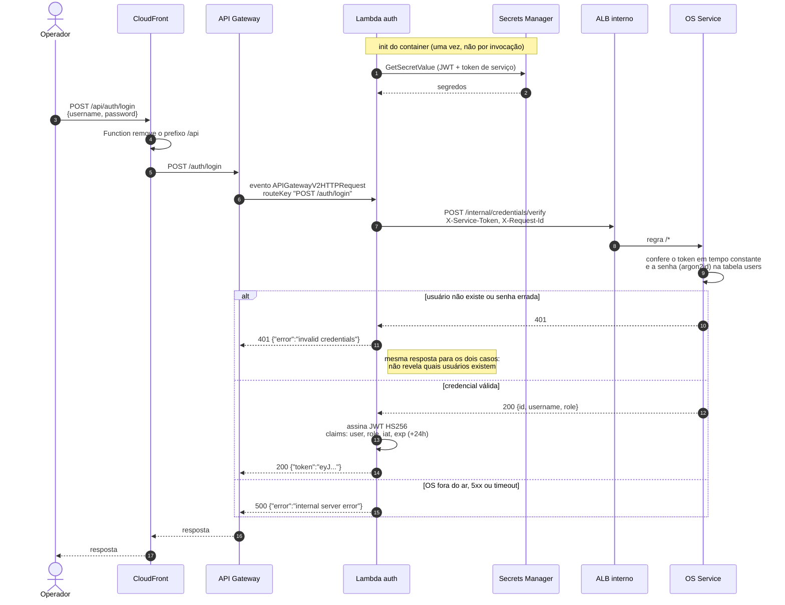
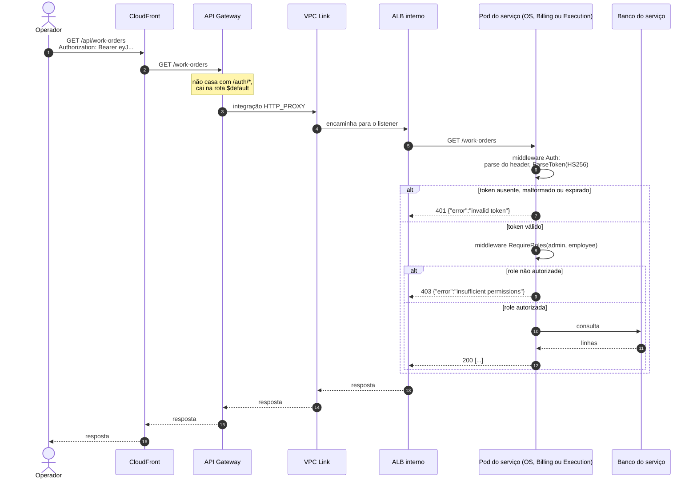

# Autenticação e autorização

Como um operador obtém um token e como esse token é aceito nas rotas
protegidas. São dois fluxos que se encontram no mesmo segredo: a Lambda
**emite** o JWT, os três serviços **validam**. Na Fase 4 a Lambda não tem banco:
para conferir a senha ela chama o OS Service, dono da tabela `users`, pelo ALB
interno ([RFC-0006, seção 8](../rfc/0006-microsservicos-e-saga.md#8-a-lambda-de-autenticação)).

O racional e as alternativas descartadas estão na [RFC-0003](../rfc/0003-estrategia-de-autenticacao.md) e na
[ADR-0009](../adr/0009-jwt-hs256-com-segredo-compartilhado.md), que também fixa a ordem exata da validação e o caminho
do segredo.

## 1. Login e emissão do token

O cadastro (`POST /auth/register`) segue o mesmo caminho para
`POST /internal/users`: 201, 409 (usuário já existe) e 400 (mensagem do OS) são
repassados ao painel.

Três detalhes que não aparecem no diagrama:

- **Os segredos são resolvidos no init do container, não por invocação.** Um
  container quente não chama o Secrets Manager de novo.
- **O token de serviço é distinto do segredo do JWT.** Os dois vivem na camada
  persistente (`oficina-mecanica/<ambiente>/internal-service-token` e
  `oficina-mecanica-<ambiente>/jwt-secret`), e vazar um não dá o outro.
- **Falha do OS Service vira 500, nunca 401.** Credencial recusada e serviço
  fora do ar continuam distinguíveis no painel e nos alertas.

## 2. Consumo de uma rota protegida

## Papéis e rotas públicas

| Papel | Alcance |
|---|---|
| `admin` | tudo, incluindo `/users` (manutenção de operadores) |
| `employee` | clientes, veículos, catálogos, OS e itens de OS |

`/users` é a única família de rotas restrita a `admin`. Papel ausente ou vazio
no token é tratado como token inválido, e não como ausência de papel.

Estas rotas não exigem `Authorization`:

| Rota | Por que é pública |
|---|---|
| `/ping`, `/ready` | healthcheck, usado pelas probes e pelo monitor externo |
| `/swagger`, `/docs/*` (e os equivalentes sob `/billing` e `/execution`) | contrato OpenAPI de cada serviço |
| `GET /public/work-orders/:code?document=...` (OS) | consulta de status, histórico e link de pagamento pelo cliente final |
| `/billing/public/quotes/*` (Billing) | aprovação e reprovação do orçamento pelo cliente final |
| `POST /billing/webhooks/mercadopago` (Billing) | notificação do Mercado Pago, validada pela assinatura `x-signature` |
| `POST /internal/*` (OS) | só para a Lambda; exige `X-Service-Token` |

As duas últimas são o canal do cliente final, e a prova de posse é o
identificador não adivinhável (UUID v4 da OS ou do serviço) somado ao documento
do cliente. A discussão de risco desse canal está na
[RFC-0003](../rfc/0003-estrategia-de-autenticacao.md).

**Os serviços não conhecem a Lambda.** Eles validam assinatura, expiração e a
presença das claims `user` e `role`. Se a Lambda for substituída por outro
emissor que assine com o mesmo segredo, nada muda nos serviços. Um teste de
contrato em cada repositório, com token *golden* fixo em
`testdata/token.golden`, garante que os dois lados não divirjam sem que o CI
perceba.
