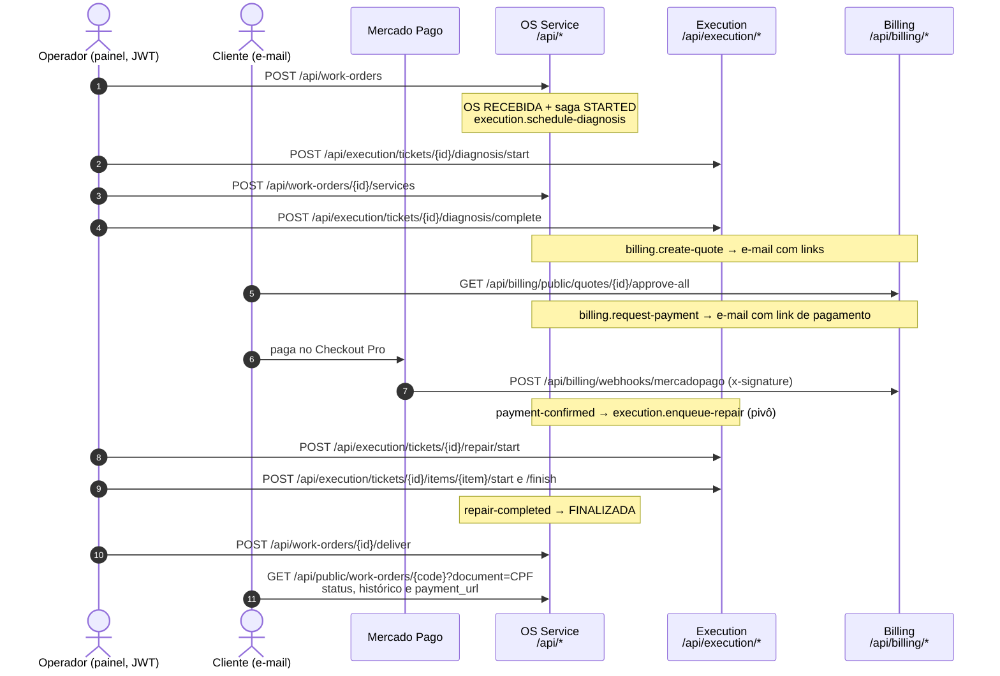

# Ciclo de vida da ordem de serviço

Na Fase 4 a OS atravessa três serviços e é coordenada por uma Saga orquestrada
no OS Service. **A fonte de verdade deste fluxo é a
[RFC-0006](../rfc/0006-microsservicos-e-saga.md)**:

| Assunto | Onde |
|---|---|
| Máquina de estados da OS (com `AGUARDANDO_PAGAMENTO`) | [RFC-0006, seção 3](../rfc/0006-microsservicos-e-saga.md#3-máquina-de-estados-da-os) |
| Passos, pivô e caminho feliz | [RFC-0006, seção 4](../rfc/0006-microsservicos-e-saga.md#4-saga-orquestrada) |
| Compensações (reprovação, pagamento recusado, bancada recusou) | [RFC-0006, seção 4](../rfc/0006-microsservicos-e-saga.md#falhas-e-compensação) |
| Prazos e reenvio | [RFC-0006, seção 4](../rfc/0006-microsservicos-e-saga.md#prazos-e-repetição) |
| Filas, tópicos e catálogo de mensagens | [RFC-0006, seção 5](../rfc/0006-microsservicos-e-saga.md#5-mensageria) |
| Mercado Pago | [RFC-0006, seção 6](../rfc/0006-microsservicos-e-saga.md#6-mercado-pago) |

Este arquivo mostra só o que a RFC não desenha: **por qual porta cada ator
entra**. Todas as chamadas passam por CloudFront e API Gateway; o prefixo
decide o serviço no listener do ALB interno.

Consultas de acompanhamento pelo operador: `GET /api/work-orders/{id}/history`
(transições com causa e `message_id`) e `GET /api/work-orders/{id}/saga` (passo
atual, prazo, tentativas e compensações pendentes). O painel "Saga" do Datadog
(`platform/datadog_dashboard_saga.tf`) mostra o mesmo de forma agregada.

Para percorrer o fluxo localmente, incluindo o pagamento pelo Mercado Pago
falso, veja [`local/README.md`](../../local/README.md).
