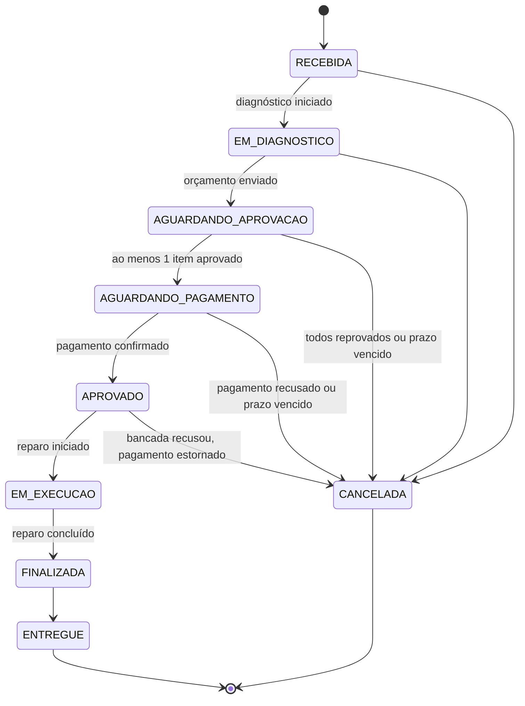
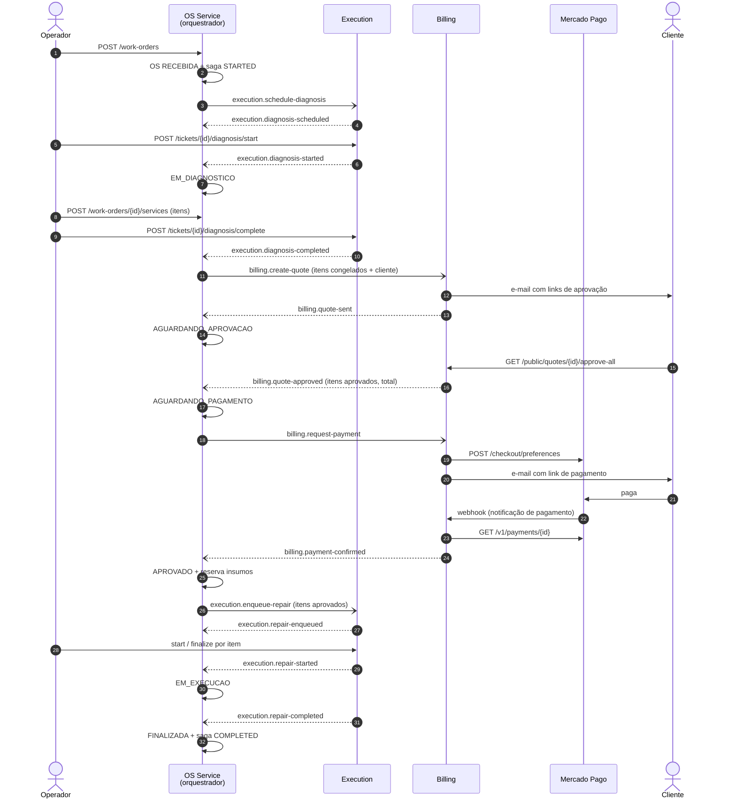
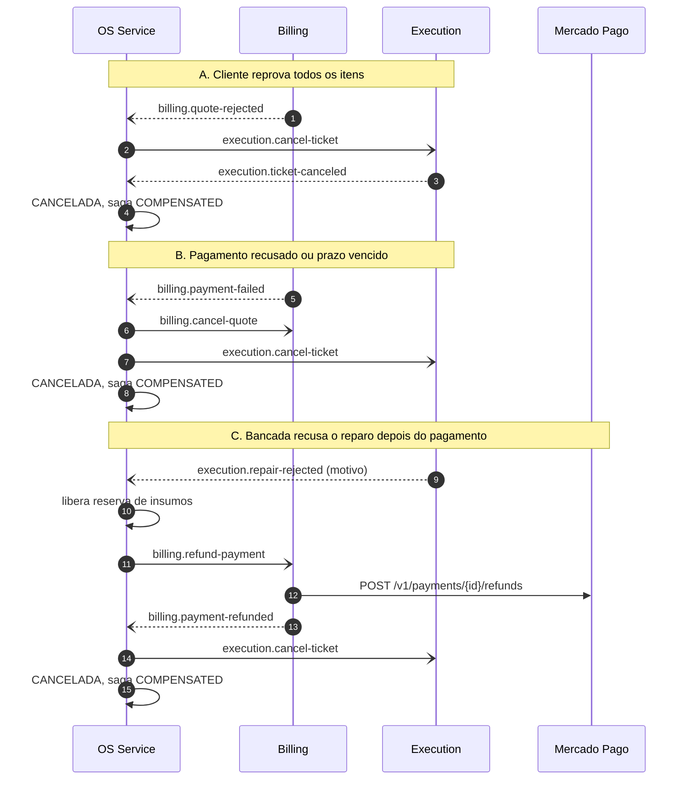
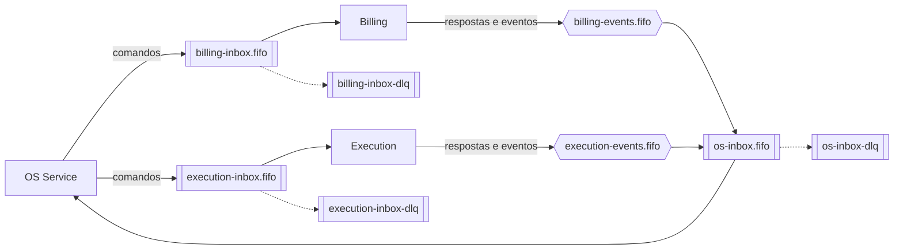

# RFC-0006. Decomposição em microsserviços e Saga orquestrada

**Em discussão** · 2026-11-11 · Substitui [ADR-0002](../adr/0002-comunicacao-sincrona-http.md) ·
Revisa [RFC-0005](./0005-segregacao-em-repositorios.md)

**Problema.** A oficina passou a operar com várias filiais. O volume de ordens de
serviço e a interação entre atendimento, diagnóstico, execução e cobrança exigem
que essas áreas evoluam e falhem de forma independente. O enunciado da Fase 4
pede no mínimo três microsserviços, cada um com repositório, infraestrutura e
banco próprios (ao menos um SQL e um NoSQL), comunicação assíncrona por
mensageria, cobrança integrada ao Mercado Pago e o Saga Pattern coordenando o
fluxo da OS, com compensação em caso de falha.

O ponto de partida é o monolito da Fase 3: um agregado único em um PostgreSQL,
consistência por transação de banco e nenhuma fila
([ADR-0002](../adr/0002-comunicacao-sincrona-http.md)). Esta RFC define o corte, o
dono de cada dado, os contratos de mensagem e a Saga que substitui a transação
local.

## 1. Os serviços

O critério de corte é **qual área da oficina é dona da decisão**. Quem decide
o que entra na OS é o atendimento, quem decide preço e cobrança é o
financeiro, quem decide a ordem do trabalho é a produção.

| Serviço | Repositório | Responsabilidade | Banco |
|---|---|---|---|
| **OS Service** | `oficina-mecanica-os-service` (renomeia o `-monolith`) | abertura da OS, itens e snapshots de preço, status e histórico, catálogos (clientes, veículos, serviços, insumos e estoque), usuários, **orquestrador da Saga** | PostgreSQL (RDS próprio) |
| **Billing Service** | `oficina-mecanica-billing-service` (novo) | geração e envio do orçamento, decisão do cliente por item, cobrança no Mercado Pago, webhook, estorno | PostgreSQL (RDS próprio) |
| **Execution Service** | `oficina-mecanica-execution-service` (novo) | fila da bancada, diagnóstico, execução item a item, conclusão | **DynamoDB** |
| Auth (Lambda) | `oficina-mecanica-serverless` | `POST /auth/login`, `POST /auth/register` | nenhum próprio (ver seção 8) |
| Painel web | `oficina-mecanica-frontend` | interface do operador | — |

Catálogos e usuários ficam no OS Service porque são lidos na abertura da OS e
mudam pouco. Extraí-los num quarto serviço só acrescentaria uma chamada
síncrona ao caminho crítico sem nenhum requisito que a justifique.

### Por que SQL no Billing e NoSQL na execução

- **Billing em PostgreSQL.** É dinheiro: orçamento, pagamento e estorno
  precisam de restrição de unicidade (um pagamento aprovado por orçamento),
  transação entre tabelas e auditoria consultável por SQL.
- **Execution em DynamoDB.** O dado é uma ficha por OS com a linha do tempo da
  bancada, sempre lida inteira pela chave da OS, e uma fila consultada por
  filial e estado. É o acesso por chave e por índice secundário que o DynamoDB
  faz bem, sem servidor para operar e com custo zero parado (sob demanda).

## 2. Propriedade de dados

Nenhum serviço lê o banco de outro. O que um serviço precisa do outro **viaja
na mensagem**: o comando de orçamento leva os itens com título e preço já
congelados ([ADR-0010](../adr/0010-snapshot-de-precos-na-ordem-de-servico.md)) e
o e-mail do cliente; o comando de execução leva os itens aprovados. Cada
serviço guarda a sua cópia, imutável, do que recebeu.

| Dado | Dono | Quem tem cópia |
|---|---|---|
| cliente, veículo, catálogo, estoque | OS | Billing (nome e e-mail do cliente, no orçamento) |
| OS, itens, status, histórico | OS | Billing (itens do orçamento), Execution (itens aprovados) |
| orçamento, decisão por item, pagamento | Billing | OS (status derivado e total aprovado) |
| fila, diagnóstico, andamento por item | Execution | OS (status derivado e carimbos de tempo) |
| estado da Saga | OS | — |

## 3. Máquina de estados da OS

Entra um estado novo, `AGUARDANDO_PAGAMENTO`, entre a aprovação do cliente e a
liberação para a bancada. `APROVADO` passa a significar **aprovado e pago**.



O OS Service passa a gravar `work_order_status_history` (status anterior,
novo, causa, `message_id` de origem e instante). A tabela removida na Fase 3
volta porque o enunciado pede **consulta de histórico**, e agora a causa de
cada transição é uma mensagem de outro serviço que precisa ser rastreável.

## 4. Saga orquestrada

### Por que orquestração e não coreografia

| Critério | Orquestrada | Coreografada |
|---|---|---|
| Onde mora o fluxo | uma máquina de estados no OS Service | espalhado nos consumidores dos três serviços |
| Compensação | o orquestrador sabe o que já foi feito e desfaz na ordem inversa | cada serviço precisa inferir o que desfazer a partir de eventos alheios |
| Inspeção | uma linha em `saga_instances` mostra passo, prazo e motivo da falha | exige reconstituir o fluxo pelos logs de três serviços |
| Acoplamento | participantes não se conhecem; conhecem só o orquestrador | participantes assinam eventos uns dos outros |
| Custo | o OS Service vira peça central do fluxo | nenhum ponto central |

O fluxo da OS é **sequencial e tem compensação em quase todo passo**. É o caso
em que a coreografia cobra mais: um ciclo de eventos entre três serviços em que
ninguém sabe dizer em que passo uma OS está. O custo da centralização é
aceitável porque o OS Service já é o dono da OS; a Saga é o ciclo de vida dela.

### Passos

| # | Passo | Participante | Tipo | Compensação |
|---|---|---|---|---|
| 1 | Abrir OS | OS (local) | compensável | `CANCELADA` |
| 2 | Agendar diagnóstico | Execution | compensável | `execution.cancel-ticket` |
| 3 | Diagnóstico concluído | Execution → OS | espera | — |
| 4 | Gerar e enviar orçamento | Billing | compensável | `billing.cancel-quote` |
| 5 | Decisão do cliente | Billing → OS | espera, com prazo | — |
| 6 | Cobrar | Billing (Mercado Pago) | compensável | `billing.refund-payment` |
| 7 | Reservar insumos | OS (local) | compensável | libera a reserva |
| 8 | Enfileirar reparo | Execution | **pivô** | — |
| 9 | Reparo iniciado e concluído | Execution → OS | repetível | — |

O **passo 8 é o pivô**: depois que a bancada aceita o reparo, a Saga só anda
para frente. Um cancelamento posterior vira processo manual (estorno pelo
painel), porque a peça já pode ter sido trocada. Antes do pivô, qualquer
falha dispara a compensação dos passos já feitos, na ordem inversa.

### Caminho feliz



### Falhas e compensação



O caso C é o que o vídeo usa para demonstrar a compensação completa. Para
provocá-lo de forma reproduzível, o Execution recusa o reparo quando a filial
está com a bancada marcada como **indisponível** (`PUT /bays/{branch}/availability`),
um estado legítimo do domínio e não um interruptor de teste.

### Prazos e repetição

O orquestrador grava `deadline_at` em cada passo de espera. Um laço no próprio
OS Service varre as sagas vencidas:

| Situação | Prazo (configurável) | Ação |
|---|---|---|
| comando sem resposta | 30 s | reenvia o mesmo comando (mesmo `message_id`), até 5 vezes; depois, compensa |
| cliente não decide o orçamento | 7 dias | trata como reprovação (caso A) |
| cliente não paga | 48 h | trata como pagamento recusado (caso B) |

Os prazos ficam em variável de ambiente para que o BDD e o vídeo usem segundos.

### Estado persistido

```text
saga_instances
  id, work_order_id (único), status (STARTED | COMPENSATING | COMPLETED | COMPENSATED | FAILED),
  current_step, completed_steps (jsonb), deadline_at, attempts, failure_reason,
  version, created_at, updated_at
```

Cada mensagem recebida avança a saga com `UPDATE ... WHERE version = $n`. Uma
mensagem fora de ordem ou repetida não casa com o passo atual e é descartada
com log `saga.message_ignored`.

## 5. Mensageria

### Topologia: SNS FIFO + SQS FIFO



- **Comandos** vão direto para a fila do participante: têm um destinatário só.
- **Respostas e eventos** saem num tópico do emissor. Hoje só o OS Service
  assina; amanhã a notificação ou o BI assinam sem mudar quem publica.
- **FIFO com `MessageGroupId = work_order_id`** garante ordem dentro de uma OS
  (`diagnosis-started` nunca chega depois de `diagnosis-completed`) sem
  serializar OS diferentes.
- **DLQ** com `maxReceiveCount = 5` e monitor de profundidade maior que zero.

SQS/SNS em vez de RabbitMQ ou Kafka: nenhum broker para operar dentro do
cluster, custo por mensagem praticamente zero no volume do projeto, IAM por
serviço via IRSA, e o LocalStack reproduz FIFO localmente e no CI.

### Envelope

```json
{
  "message_id": "uuid v7",
  "type": "billing.quote-approved",
  "version": 1,
  "saga_id": "uuid",
  "work_order_id": "uuid",
  "correlation_id": "id da requisição HTTP que iniciou a OS",
  "causation_id": "message_id da mensagem que causou esta",
  "occurred_at": "2026-11-11T10:00:00Z",
  "payload": {}
}
```

O contexto de trace (`traceparent` e cabeçalhos do Datadog) vai em
**message attributes** e é reinjetado no consumidor. É o que liga, num único
trace, a requisição do operador, a mensagem, o consumidor e a chamada ao
Mercado Pago ([ADR-0011](../adr/0011-logs-estruturados-com-correlacao.md)).

### Catálogo de mensagens

| Tipo | De → para | Payload principal |
|---|---|---|
| `execution.schedule-diagnosis` | OS → EX | filial, veículo, título da OS |
| `execution.diagnosis-scheduled` | EX → OS | posição na fila |
| `execution.diagnosis-started` | EX → OS | técnico, instante |
| `execution.diagnosis-completed` | EX → OS | instante, observações |
| `billing.create-quote` | OS → BI | cliente (nome, e-mail), itens (id, título, preço, tempo), faltas de insumo |
| `billing.quote-sent` | BI → OS | `quote_id`, total |
| `billing.quote-approved` | BI → OS | itens aprovados, total aprovado |
| `billing.quote-rejected` | BI → OS | motivo (`CLIENTE` ou `PRAZO`) |
| `billing.request-payment` | OS → BI | `quote_id` |
| `billing.payment-requested` | BI → OS | link de pagamento, expiração |
| `billing.payment-confirmed` | BI → OS | `payment_id` do Mercado Pago, valor |
| `billing.payment-failed` | BI → OS | motivo (`RECUSADO`, `EXPIRADO`) |
| `billing.refund-payment` | OS → BI | motivo |
| `billing.payment-refunded` | BI → OS | `refund_id` |
| `billing.cancel-quote` | OS → BI | motivo |
| `execution.enqueue-repair` | OS → EX | itens aprovados |
| `execution.repair-enqueued` | EX → OS | posição na fila |
| `execution.repair-rejected` | EX → OS | motivo |
| `execution.repair-started` | EX → OS | técnico, instante |
| `execution.item-finished` | EX → OS | item, instante |
| `execution.repair-completed` | EX → OS | instante |
| `execution.cancel-ticket` | OS → EX | motivo |
| `execution.ticket-canceled` | EX → OS | — |

Os schemas ficam versionados em JSON Schema no repositório do OS Service
(`contracts/messages/`), e cada participante tem um teste de contrato contra
eles, no mesmo espírito do teste que já amarra o OpenAPI às rotas.

### Entrega confiável

- **Outbox transacional** nos três serviços. A mudança de estado e a mensagem a
  publicar são gravadas na mesma transação (tabela `outbox` no PostgreSQL;
  item `OUTBOX#` no mesmo `TransactWriteItems` no DynamoDB). Um publicador no
  próprio processo envia e marca como publicado. Sem outbox, um pod que morre
  entre o `COMMIT` e o `Publish` deixaria a Saga parada para sempre.
- **Consumidor idempotente.** Cada serviço grava `message_id` em
  `processed_messages` (ou item `MSG#` com escrita condicional) na mesma
  transação do efeito. A entrega do SQS é pelo menos uma vez; o efeito é
  exatamente uma vez.

## 6. Mercado Pago

Integração por **Checkout Pro** no ambiente de testes (usuários e cartões de
teste do Mercado Pago):

1. `billing.request-payment` → `POST /checkout/preferences` com os itens
   aprovados, `external_reference = quote_id`, `notification_url` apontando
   para `/billing/webhooks/mercadopago` e `expiration_date_to` igual ao prazo
   de pagamento da Saga.
2. O link (`init_point`) vai ao cliente por e-mail e no retorno da consulta
   pública da OS.
3. O webhook **não é fonte da verdade**: o Billing valida a assinatura
   `x-signature`, ignora o corpo e busca o pagamento em `GET /v1/payments/{id}`.
   Só `approved` vira `payment-confirmed`; `rejected` e `cancelled` viram
   `payment-failed`.
4. Estorno por `POST /v1/payments/{id}/refunds`, com chave de idempotência
   igual ao `message_id` do comando.

O access token fica no Secrets Manager e chega ao pod por variável de ambiente
via External Secrets ou pelo próprio pipeline. Testes unitários usam um fake
HTTP; o BDD usa o mesmo fake, para não depender da rede do Mercado Pago.

## 7. Borda e roteamento

O API Gateway continua sendo a única porta pública
([ADR-0003](../adr/0003-api-gateway-como-unica-porta-publica.md)). O ALB interno
continua sendo criado pelo Terraform da plataforma, porque o VPC Link precisa do
ARN do listener no momento do plan. Cada serviço cria, no próprio Terraform, um
target group e uma regra de caminho nesse listener, e o pod entra no target
group por um `TargetGroupBinding` no `k8s/` do serviço, o mesmo mecanismo que a
Fase 3 já usa:

| Prefixo | Destino |
|---|---|
| `/auth/*` | Lambda |
| `/billing/*` (inclui `/billing/public/quotes/*` e `/billing/webhooks/*`) | Billing |
| `/execution/*` | Execution |
| `$default` | OS Service |

O painel web ganha as telas da bancada (Execution) e passa a chamar os três
prefixos. Os links públicos de aprovação mudam de dono: saem de
`/public/approvals/*` do monolito para `/billing/public/quotes/*`.

## 8. A Lambda de autenticação

Hoje a Lambda lê a tabela `users` do banco do monolito, o que passa a violar a
regra de banco por serviço. Proposta: o OS Service expõe
`POST /internal/credentials/verify`, protegido por um token de serviço
(segredo próprio no Secrets Manager, distinto do segredo do JWT). A Lambda
chama esse endpoint pelo ALB interno e continua emitindo o JWT. O CRUD de
usuários permanece no OS Service.

Alternativa descartada: mover `users` para um banco da própria Lambda. Os IDs
de usuário são referenciados pela OS (quem abriu, técnico responsável), e o
painel de usuários teria de mudar de serviço junto, um custo que o enunciado
não pede.

## 9. Infraestrutura por repositório

Revisão da [RFC-0005](./0005-segregacao-em-repositorios.md): o
`-infrastructure` continua dono da **plataforma compartilhada** (VPC, EKS, ALB
Controller, API Gateway, CloudFront, observabilidade), e cada serviço passa a
ter, no próprio repositório:

```text
infra/        Terraform com state próprio: banco do serviço, filas e tópico
              que ele possui, role IRSA, repositório ECR, segredos
k8s/          Deployment, Service, HPA, PDB, ServiceAccount e TargetGroupBinding (kustomize)
.github/      lint, test (cobertura >= 80%), quality (SonarQube), build e deploy
```

A plataforma publica no SSM o que os serviços consomem, como já faz hoje
([ADR-0007](../adr/0007-contrato-entre-repositorios-via-ssm.md)). Aos parâmetros
atuais (`vpc_id`, `private_subnet_ids`, `eks_cluster_name`, `kube_namespace`)
somam-se quatro novos:

| Parâmetro | Usado para |
|---|---|
| `eks_oidc_provider_arn` | trust policy da role IRSA de cada serviço |
| `eks_node_security_group_id` | liberar a porta do RDS do serviço para os pods |
| `alb_listener_arn` | regra de caminho do serviço no ALB interno |
| `public_base_url` | links enviados por e-mail (aprovação, pagamento) |

Os manifestos saem de `ephemeral/k8s.tf` e passam a ser YAML no repositório de
cada serviço, aplicados pelo pipeline com `kubectl kustomize | kubectl apply`.
O ECR também muda de dono: cada serviço cria o seu.

**Quem cria cada fila:** o dono da fila é quem consome. `billing-inbox` nasce no
Terraform do Billing; `os-inbox` e a assinatura nos tópicos nascem no do OS
Service. O ARN de cada tópico é publicado no SSM pelo emissor.

## 10. Desenvolvimento local e testes

- `docker-compose` por serviço com PostgreSQL ou DynamoDB Local e LocalStack
  (SQS/SNS FIFO); um compose no `-infrastructure/local` sobe os três juntos.
- **Unitários** em todos os serviços; cobertura medida no CI e **barrada abaixo
  de 80%** pelo Quality Gate do SonarQube.
- **BDD (godog)** no OS Service, cobrindo o fluxo completo com os três
  serviços reais sobre LocalStack e o Mercado Pago falso:

```gherkin
Funcionalidade: Ciclo de vida da ordem de serviço

  Cenário: OS paga é executada até o fim
    Dado uma OS aberta para um cliente com veículo cadastrado
    Quando o diagnóstico é concluído com 2 serviços
    E o cliente aprova o orçamento
    E o Mercado Pago confirma o pagamento
    E a bancada conclui o reparo
    Então a OS fica FINALIZADA
    E o histórico mostra as 7 transições na ordem

  Cenário: bancada recusa o reparo depois do pagamento
    Dado uma OS com pagamento confirmado
    E a bancada da filial está indisponível
    Quando a OS é enviada para execução
    Então o pagamento é estornado no Mercado Pago
    E a reserva de insumos é liberada
    E a OS fica CANCELADA
```

## 11. Observabilidade

Mantém o Datadog da Fase 3 ([RFC-0004](./0004-estrategia-de-observabilidade.md)),
com três acréscimos:

- **APM nos três serviços** com propagação de contexto pelas mensagens, para que
  uma OS apareça como um único trace distribuído;
- logs com `@saga_id`, `@work_order_id` e `@message_type`, além dos campos da
  [ADR-0011](../adr/0011-logs-estruturados-com-correlacao.md);
- painel da Saga: sagas por status, tempo por passo, compensações por motivo e
  profundidade das DLQs, com monitor para DLQ maior que zero e saga parada além
  do prazo.

## Decisões que esta RFC origina

| ADR | Decisão |
|---|---|
| [ADR-0012](../adr/0012-tres-microsservicos-por-area-de-decisao.md) | Três microsserviços por área de decisão; dados viajam na mensagem |
| [ADR-0013](../adr/0013-saga-orquestrada-no-os-service.md) | Saga orquestrada no OS Service, pivô no enfileiramento do reparo |
| [ADR-0014](../adr/0014-sns-sqs-fifo-com-outbox.md) | SNS FIFO + SQS FIFO com outbox e consumidor idempotente |
| [ADR-0015](../adr/0015-dynamodb-no-execution-postgresql-no-os-e-billing.md) | DynamoDB no Execution, PostgreSQL no OS e no Billing |
| [ADR-0016](../adr/0016-mercado-pago-checkout-pro.md) | Mercado Pago Checkout Pro, webhook validado por consulta |
| [ADR-0017](../adr/0017-infra-e-manifestos-no-repositorio-do-servico.md) | Infraestrutura e manifestos Kubernetes no repositório de cada serviço |

## Consequências

| Ganhos | Custos |
|---|---|
| Atendimento, cobrança e bancada evoluem e falham separados | consistência eventual: a OS mostra o status do último evento recebido, não o do instante |
| Falha de pagamento ou da bancada é desfeita sem intervenção manual até o pivô | três pipelines, três states de Terraform e dois RDS a mais para manter |
| Uma OS é rastreável de ponta a ponta num trace e numa linha de `saga_instances` | outbox, idempotência e prazos são código novo em cada serviço |
| Filas absorvem picos e indisponibilidades curtas de um participante | o OS Service vira peça central do fluxo; se cair, as sagas param (mas não se perdem: as mensagens esperam na fila) |
